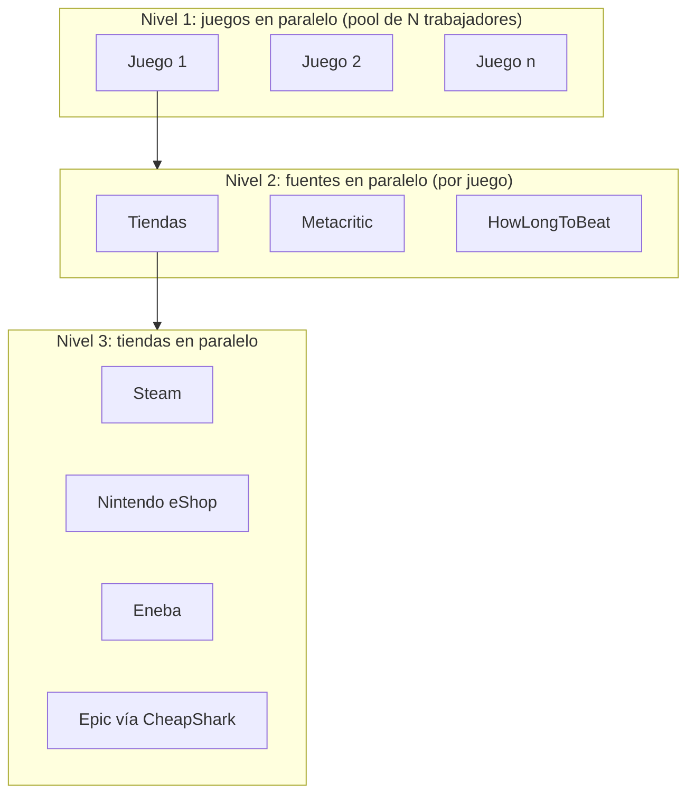
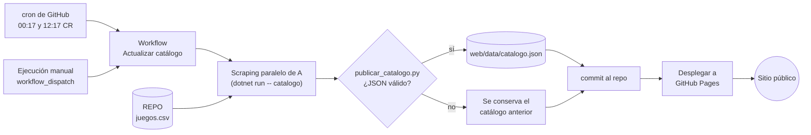

# III Proyecto: Web Scraping Multinúcleo y Sitio Web — Documento técnico

IC3101 Arquitectura de Computadoras · TEC San Carlos · Entrega: 18 de noviembre de 2026

| Integrante | Rol | Secciones |
|---|---|---|
| *(nombre)* | A — Núcleo paralelo y rendimiento | 1, 5 y sincronización |
| *(nombre)* | B — REPO y web scraping | 2, 3 y 4.1 |
| *(nombre)* | C — Sitio web, despliegue y actualización | 4.2, 4.3, 6, anexo y consolidación |

**URL pública:** `https://USUARIO.github.io/REPOSITORIO/` · **Código:** `https://github.com/USUARIO/REPOSITORIO`

**Decisiones de tecnología del equipo:** lenguaje **C# (.NET 8)** para scraping y paralelismo; datos y hosting en
**GitHub** (REPO como CSV en el repositorio, catálogo como JSON publicado, GitHub Actions como programador y
GitHub Pages como hosting); sitio web en HTML, CSS y JavaScript sin dependencias.

## Índice
1. Arquitectura y paralelismo en tres niveles
2. Estructura del REPO y cómo se actualiza
3. Estrategia de scraping por sitio e indicador de oferta
4. Manejo de errores y mecanismo de actualización recurrente
5. Resultados de rendimiento y conclusiones
6. Instalación, ejecución y URL pública
- Anexo A. Sitio web: criterios de filtros, orden y datos faltantes
- Anexo B. Contratos de datos

---

## Sección 1. Arquitectura y paralelismo en tres niveles

> **PENDIENTE — Persona A.** Debe incluir:
> - Diagrama de los 3 niveles anidados (juegos → fuentes → tiendas) y tamaño de cada pool.
> - Justificación de hilos vs. procesos (scraping = trabajo de espera de red / I/O) y del número de trabajadores.
> - Sincronización: qué se comparte (cola de trabajo, escritura del catálogo, contadores, log) y con qué se protege.
> - Límite de concurrencia por dominio y pausas (semáforo por dominio).
> - Cómo se consolida el registro final (Contrato 2) y cómo se conserva el último dato bueno si una fuente falla.


*(Diagrama base para que A lo ajuste a su implementación.)*

---

## Sección 2. Estructura del REPO y cómo se actualiza

### 2.1 Dónde vive y qué contiene
El REPO es el archivo `Data/juegos.csv` (UTF-8, separado por `;`). Una **fila = un juego en una plataforma**
(Elden Ring en PS5 y en PC son dos filas, porque Metacritic y las tiendas dan datos distintos por plataforma).

| Columna | Obligatoria | Uso |
|---|---|---|
| `id` | sí | Identificador único de la fila |
| `nombre` | sí | Nombre del juego |
| `plataforma` | sí | `PS5`, `PS4`, `Xbox Series`, `Xbox One`, `PC`, `Switch` |
| `fecha_lanzamiento` | sí | `aaaa-mm-dd` |
| `precio_sugerido` | sí | USD, precio de referencia |
| `imagen_url` | no | Imagen de respaldo si ninguna tienda la entrega |
| `steam_appid` | no | Evita la búsqueda por nombre en Steam |
| `nombre_busqueda` | no | Nombre exacto en las fuentes cuando difiere (también cuenta como nombre aceptado) |
| `metacritic_slug` | no | Parte de la URL de Metacritic (`elden-ring`) |
| `hltb_id` | no | Id numérico de HowLongToBeat (ruta más estable que la búsqueda) |

**Tamaño:** 249 juegos distintos (660 filas por plataforma). El enunciado pide 200 juegos: se cuentan juegos
*distintos*, no filas, y por eso el programa lo reporta así (`dotnet run`). El archivo original tenía 136 juegos
distintos (347 filas), que habría fallado el requisito.

### 2.2 Cómo se modifica sin tocar el código
Se edita `Data/juegos.csv` (Excel o cualquier editor) y se vuelve a correr. El REPO **se lee completo en cada ejecución**;
no hay lista en el código. Detalles de robustez de la lectura:
- Las columnas se reconocen por el **nombre del encabezado**, no por posición.
- Una fila mala (id repetido, fecha inválida, plataforma desconocida, precio ≤ 0, juego+plataforma repetido)
  se **reporta con su número de línea** y **no detiene** la carga de las demás.
- Acepta `59,99` y `10/11/2026` por si Excel cambia el formato.

**Demostración para la defensa:** agregar una línea al CSV, correr `dotnet run` (sube el conteo) y
`dotnet run -- probar 1 --juego "Nombre nuevo"` (el juego nuevo se consulta).

### 2.3 Dónde vive el REPO (GitHub en vez de Firebase)
El equipo decidió no usar una base de datos en la nube: el REPO vive en el repositorio de GitHub
(`ScraperJuegos/Data/juegos.csv`) y se edita desde la web de GitHub o con un commit. La actualización automática
descarga el repositorio en cada corrida, así que **siempre usa la versión más reciente del REPO** (ver sección 4.2).
A solo conoce la interfaz `IRepoJuegos` (`Cargar()`), no el CSV: si en el futuro se quisiera una base de datos, basta
otra clase que implemente esa interfaz. `dotnet run -- exportar` genera el REPO en JSON.

---

## Sección 3. Estrategia de scraping por sitio e indicador de oferta

### 3.1 Fuentes
| Fuente | Qué da | Cómo se consulta | Plataformas |
|---|---|---|---|
| **Steam** (tienda 1) | precio actual, regular, enlace, imagen | JSON de la propia tienda: `/api/storesearch` (1 solicitud/juego); `/api/appdetails` si el REPO trae `steam_appid`. USD (`cc=us`) | PC |
| **Epic Games Store** (tienda 2, **vía CheapShark**) | precio actual, regular, enlace, imagen | La tienda directa responde 403 y no se evade. Se usa la API pública y gratuita de CheapShark, un comparador de precios que rastrea Epic: `GET www.cheapshark.com/api/1.0/deals?storeID=25&title=...&exact=1` (y `exact=0` solo si no hay coincidencia exacta). Precios en USD como texto; enlace por el redireccionador de CheapShark a la página del juego en Epic. **El dato llega por intermediario y puede tener horas de atraso.** | PC |
| **Nintendo eShop** (tienda 3) | precio actual, regular, enlace, imagen | índice de búsqueda de nintendo.com (Algolia, clave pública de solo búsqueda, configurable por `NINTENDO_ALGOLIA_KEY`); campos `msrp` / `salePrice` | Switch |
| **Eneba** (tienda 4) | precio de la clave más barata (sin precio regular), enlace, imagen | página de búsqueda; solo datos estructurados schema.org (JSON-LD). Solo claves GLOBAL, solo USD, plataforma deducida del nombre | PC, PS5, PS4, Xbox, Switch |
| **Metacritic** | Metascore **de la consola del REPO** | `/game/{slug}/?platform={plataforma}`; JSON-LD y, de respaldo, HTML | todas |
| **HowLongToBeat** | horas (completo = *Completionist*; también principal y extra) | solo la página pública del juego `https://howlongtobeat.com/game/{hltb_id}` (el `hltb_id` es dato del REPO). **No** usa el buscador `/api` | todas |

`formato` es `digital` en todas las tiendas. **Limitación conocida:** ninguna tienda implementada vende físico, así que el
filtro "físico" quedará vacío salvo que el equipo agregue una fuente física (por ejemplo Amazon, que suele bloquear).
Xbox solo tiene precio vía Eneba (claves); Switch vía Nintendo eShop y Eneba. Los conteos de cobertura los calcula `dotnet run` a partir de la lista de tiendas.
Agregar una tienda = una clase que implemente `ITiendaScraper` + una línea en `TiendasDisponibles.cs` + su nombre en `Catalogos.Tiendas` (una prueba avisa si se olvida).

### 3.2 Coincidencia de nombres y plataforma
El mismo juego se llama distinto en cada sitio (`EA SPORTS FC™ 24`, `ELDEN RING Deluxe Edition`). Estrategia:
1. **Normalizar:** sin tildes, minúsculas, sin ™ ® ©, `&` → `and`, sin puntuación, "the" inicial fuera, romanos → dígitos
   (VII = 7) y sin sufijos de edición (*Standard/Deluxe/Ultimate/Complete Edition, GOTY, Director's Cut, Remastered…*).
2. **Coincidencia = nombres normalizados iguales.** Por eso `Doom` ≠ `Doom Eternal`, `God of War` ≠ `God of War Ragnarök`,
   `FIFA 23` ≠ `FIFA 22`.
3. **Verificar plataforma** en cada fuente (Steam: Windows; Nintendo: Switch; Eneba: la plataforma deducida del título; Metacritic: `gamePlatform`).
   En Epic (vía CheapShark) se descartan los títulos que no coinciden con el juego (DLC, bandas sonoras, ediciones con otro nombre) y, entre ediciones del mismo juego, se toma la más barata (la base).
4. **Si hay duda se devuelve `no_encontrado`; nunca se adivina.** En HLTB, ante varios juegos con el mismo nombre
   (remakes) el `hltb_id` del REPO identifica el juego exacto, y el scraper verifica que el nombre de la página coincida.
5. Si un nombre legítimo no coincide (ej. PC: *Marvel's Spider-Man* vs *Marvel's Spider-Man Remastered*), se corrige en el
   REPO con `nombre_busqueda`, que es el nombre exacto que se acepta.

### 3.3 Indicador de oferta (fórmula del equipo)
1. **Principal (por tienda):** en oferta si `precio_actual < precio_regular` de esa tienda.
   `descuento % = (precio_regular − precio_actual) / precio_regular × 100`
2. **Apoyo:** si la tienda no informa `precio_regular`, se compara contra el `precio_sugerido` del REPO con la misma fórmula.
3. Si no se cumple ninguna: no está en oferta, descuento 0.

Ejemplo: regular 59.99, actual 29.99 → (59.99 − 29.99) / 59.99 × 100 = **50.01 %**, en oferta.
Tolerancia de 1 centavo (evita falsos positivos por redondeo). Todo en USD para ser comparable con el precio sugerido.
**Mejor precio:** el **menor** `precio_actual` entre las tiendas que respondieron (empate: mayor descuento). El precio tachado
y el porcentaje que se muestran son los **de esa misma tienda**, así `en_oferta`, `descuento_pct` y la tarjeta son coherentes.
Implementado en `Oferta/CalculadorOferta.cs` (`Evaluar` y `Consolidar`) para que A lo llame sin reimplementarlo.

### 3.3b Moneda
Todo se compara en **USD**. Si una tienda responde en otra moneda, su scraper devuelve `formato_cambiado` y, como segunda barrera,
`CalculadorOferta.Consolidar` ignora cualquier resultado con `moneda` distinta de USD, para que nunca gane un "mejor precio" falso.
Eneba no tiene precio regular: se omite `precio_regular` y la oferta se evalúa contra el `precio_sugerido` del REPO.

### 3.3c Juegos fuera del REPO y cambios
- `dotnet run -- probar --juego "Nombre"`: si no está en el REPO se consulta igual (PC, PS5 y Switch, o la de `--plataforma`); con `--precio` se evalúa la oferta y con `--anio` HowLongToBeat desempata. Sin resultados -> `no_encontrado`, nunca una caída.
- Un scraper con un error de programación no detiene la prueba (`TiendasDisponibles.ConsultarSeguroAsync`); `Program` captura cualquier excepción y sale con un mensaje.
- El CSV se puede leer aunque esté abierto en Excel; un archivo ilegible o inexistente se reporta como error del REPO.

### 3.4 Imagen
Steam entrega `header_image` (o `…/steam/apps/{id}/header.jpg`); Epic, Nintendo y Eneba entregan la imagen de su ficha.
Si ninguna tienda responde, C usa `imagen_url` del REPO.

### 3.5 Términos de uso y cortesía — qué se revisó
El cliente HTTP **lee el `robots.txt` de cada dominio antes de pedir cualquier URL** (RFC 9309: grupo propio o `*`, regla más
específica gana, respeta `Crawl-delay`). Si no lo puede leer, **no pide nada**. Cada bloqueo queda en el log.
Además: User-Agent honesto (`ScraperJuegosTEC/1.0 (proyecto academico IC3101 TEC San Carlos; contacto: …)`), pausa mínima de
1 s entre solicitudes al mismo dominio y máximo 2 simultáneas por dominio.

| Sitio | Estado de la revisión | Pendiente |
|---|---|---|
| store.steampowered.com | Fuentes secundarias indican que su `robots.txt` es abierto, y que `api.steampowered.com` sí prohíbe acceso automatizado (por eso **no** se usa). | Verificar el `robots.txt` y los Términos de Steam y anotar fecha |
| store.playstation.com | **PlayStation Store se eliminó del proyecto (decisión del equipo).** Evidencia (11-nov-2026, `dotnet run -- diagnostico`): `robots.txt` permite `/en-us/search/` y la página responde HTTP 200, pero el HTML ya no trae resultados (solo casillas de carga); los productos los pide el navegador a una API interna sin documentación pública, que no se considera apropiado leer sin autorización. | Mencionar en el informe como limitación: PS4/PS5 conservan Metacritic, HowLongToBeat y los precios de Eneba (claves) |
| store.epicgames.com | **Observado el 11-nov-2026 con `dotnet run -- diagnostico`:** la tienda responde HTTP 403 (acceso denegado) a las consultas automáticas. El scraper lo clasifica como `bloqueo`, no reintenta y no intenta evadirlo (respeto a los términos y a las medidas anti-bots del sitio). **Decisión:** no se evade; los precios de Epic se obtienen de la API pública de CheapShark (`EpicCheapSharkScraper`, ver 3.1). El acceso directo (`EpicGamesScraper`) queda en el código como evidencia, sin registrar. | Anotar la fecha de la revisión de `robots.txt` y términos con el `informe.txt` |
| nintendo.com / algolia.net | No verificado. La clave de búsqueda es pública pero puede rotar (403 -> `bloqueo`); el índice puede cambiar de nombre (`NINTENDO_ALGOLIA_INDEX`) | Revisar términos de Nintendo y `robots.txt` de ambos dominios |
| eneba.com | No verificado. Es el sitio más propenso a anti-bots; `bloqueo` / `formato_cambiado` son resultados esperables. La vía oficial es su API de afiliados (requiere registro) | Revisar `robots.txt`/términos; si bloquea, documentarlo como limitación |
| metacritic.com | No verificado. Es la fuente más propensa a bloqueo y sus términos son restrictivos | Revisar; si bloquea, documentar el cambio |
| howlongtobeat.com | **Verificado con `dotnet run -- diagnostico`** (anotar fecha de la corrida): su `robots.txt` prohíbe `/api` (`Disallow: /api`), que es el buscador interno; en cambio `/game/ID` está PERMITIDO (ninguna regla aplica a esa ruta). Por eso el scraper usa solo `/game/ID` y el `hltb_id` se guarda en el REPO. | Anotar la fecha y adjuntar `salida/diagnostico/informe.txt`; mencionar a HowLongToBeat como fuente en el sitio |

| wikidata.org (solo `hltb-autocompletar`) | Se usa su **API pública** (`/w/api.php`) con User-Agent descriptivo y 1 solicitud/s, como pide la etiqueta de la API de Wikimedia. En esta única herramienta no se consulta `robots.txt` (regula a rastreadores de páginas, no a la API); el resto del proyecto sí lo respeta siempre. No corre durante el scraping normal. | Anotar fecha de la primera corrida; definir `SCRAPER_CONTACTO` |

**Apagar tiendas caídas sin recompilar:** variable de entorno `TIENDAS_DESACTIVADAS` (ej. `Epic Games Store,Eneba`).
Una tienda apagada no consume solicitudes ni ensucia el log ni las mediciones de rendimiento. Es una decisión de configuración, no de código.

> Estas revisiones **no se pudieron hacer en vivo** al desarrollar (sin acceso a esos sitios). Antes de la entrega:
> abrir cada `robots.txt` y los términos, y anotar aquí fecha y conclusión como evidencia para la defensa.


### 3.5b Registro de revisión de robots.txt y términos (completar antes de entregar)
Una fila por sitio. Fecha = día en que se abrió el `robots.txt` y la página de términos. Conclusión = qué se permite y qué ruta usa el scraper.

| Sitio | URL de robots.txt | URL de términos | Fecha revisada | Conclusión / ruta usada |
|---|---|---|---|---|
| Steam | store.steampowered.com/robots.txt | steampowered.com/subscriber_agreement | ____ | ____ |
| Nintendo | nintendo.com/robots.txt y algolia.net | nintendo.com/en-US/Legal/ | ____ | ____ |
| Eneba | eneba.com/robots.txt | eneba.com (términos) | ____ | ____ |
| Metacritic | metacritic.com/robots.txt | fandom.com/terms-of-use | ____ | ____ |
| HowLongToBeat | howlongtobeat.com/robots.txt | howlongtobeat.com (términos) | ____ | `/api` prohibido; solo `/game/ID` |
| Wikidata | wikidata.org/robots.txt | API etiquette de Wikimedia | ____ | API pública, 1 solicitud/s |
| CheapShark (Epic) | cheapshark.com/robots.txt | apidocs.cheapshark.com | ____ | API pública sin clave; `/api/1.0/deals`, 1 solicitud/s; si robots.txt no permite `/api`, el scraper lo reporta como bloqueo |
| Epic (directo) | store.epicgames.com/robots.txt | epicgames.com/site/es-ES/tos | 11-nov-2026 | Responde 403 a consultas automáticas; no se evade (se usa CheapShark) |

Adjuntar `salida/diagnostico/informe.txt` de la corrida de `diagnostico` como evidencia.

### 3.6 Limitaciones conocidas (para la defensa)
- **Formato físico:** las tiendas implementadas solo venden digital; el filtro "físico" queda vacío. Amazon y similares bloquean el scraping y el reparto indica no pelear con bloqueos. Decisión del equipo: ____.
- **Cobertura de tiendas:** PC tiene Steam, Epic Games Store (vía CheapShark, porque la tienda directa responde 403) y Eneba; Switch tiene Nintendo eShop y Eneba; PS4, PS5 y Xbox solo tienen Eneba (PlayStation Store se eliminó). **En las pruebas reales, Eneba no devolvió claves de PlayStation para ningún juego (solo PC y Xbox)**: las versiones de PS4/PS5 quedan sin precio; los juegos multiplataforma tienen precio por sus otras plataformas y solo 6 exclusivos de PlayStation (Bloodborne, Gran Turismo 7, Astro Bot, Demon's Souls, Death Stranding 2, Ghost of Yōtei) quedan sin ninguna tienda. Se evaluó la API de PlatPrices (requiere clave) y el equipo decidió no depender de un servicio con clave. Con el REPO actual, 184 de 249 juegos tenían precio en 2 tiendas distintas antes de agregar Epic (volver a contar con `dotnet run`). Si Eneba bloquea, PS y Xbox quedan sin precio.
- **REPO local:** vive en `Data/juegos.csv` (cumple "dinámico"); `exportar` genera el JSON para cargarlo a la nube si el equipo lo decide.

### 3.6b HowLongToBeat: por qué `/game/ID` y de dónde salen las horas y fechas
- **Regla del sitio:** el `robots.txt` de HLTB prohíbe `/api` (el buscador interno). El proyecto respeta robots.txt, así que **no** usa
  `/api`; solo lee la página pública `https://howlongtobeat.com/game/ID`, que sí está permitida. HLTB se cita como fuente en el sitio.
- **El `hltb_id`** (el número de la URL del juego en HLTB) es un dato del REPO, como `steam_appid`: se escribe una vez por juego en
  `Data/juegos.csv` (las demás plataformas del mismo juego lo heredan). Sin `hltb_id` el scraper devuelve `no_encontrado` con una
  instrucción clara; nunca adivina ni toca `/api`. Se verifica que el nombre de la página coincida con el del REPO (detecta ids mal copiados).
- **Los tiempos NO están guardados ni "quemados"**: se leen en vivo de la página en cada consulta. Cada resultado trae `fecha_consulta`
  con la hora real (`DateTimeOffset.UtcNow`) del momento de la consulta; no hay fechas fijas en el código (solo `fecha_lanzamiento`,
  que es un dato del REPO). Una prueba automática lo comprueba.
- **Cómo se obtienen los ids sin llenarlos a mano (`dotnet run -- hltb-autocompletar --aplicar`):** como HLTB no permite su buscador,
  el id se descubre en **Wikidata**, que guarda para muchos videojuegos la propiedad «HowLongToBeat ID» (P2816; configurable con
  `HLTB_WIKIDATA_PROP`) y ofrece una API pública. Estrategia sin adivinar: se busca por nombre; el nombre debe coincidir tras normalizar
  (mismo criterio de §3.2); si la descripción trae un año y difiere más de 1 año del REPO se descarta (distingue un remake del original);
  si queda **un** id -> se usa; si no hay ninguno -> `no_encontrado`; si hay varios distintos -> `ambiguo` (se deja para llenar a mano).
  Es una herramienta de preparación del REPO (se corre una vez, no en cada scraping): 2 solicitudes por juego, 1 por segundo.
  Luego `hltb-verificar` confirma contra la página real `/game/ID` que cada id es ese juego y trae tiempos; los ids malos se detectan ahí.
  Los juegos que Wikidata no resuelva quedan en `salida/hltb_autocompletar.csv` con un enlace de búsqueda para completarlos manualmente.
- Comandos: `hltb-autocompletar` (descubre ids), `hltb-pendientes` (lista los que faltan), `hltb-importar` (copia ids al REPO), `hltb-verificar` (confirma cada id contra la página real).

---

### 3.7 HowLongToBeat: fuente y campos (revisión)

- **Fuente:** HowLongToBeat (https://howlongtobeat.com). Debe citarse como fuente de los tiempos en el sitio web y en el informe.
- **Qué se revisó:** su `robots.txt` contiene `Disallow: /api` (el buscador interno) y no restringe `/game/ID`. Por eso el scraper **nunca** llama a `/api`; solo lee la página pública `https://howlongtobeat.com/game/ID`, con User-Agent honesto, pausa de 1 s por dominio, timeout y reintentos.
- **Campos que se recuperan de la página:** horas 100 % (completionist), historia principal, historia + extras, todos los estilos, nombre en HLTB, desarrollador, plataformas, año de lanzamiento, nota de usuarios, número de reseñas, cuántos lo completaron / lo juegan / lo tienen pendiente / lo abandonaron, e imagen. Lo que HLTB no publique se guarda como vacío y la web muestra "N/D".
- **Requisito:** cada juego necesita su `hltb_id` (el número de la URL) en `Data/juegos.csv`; si falta, se devuelve `no_encontrado` con un mensaje claro (no se adivina ni se usa `/api`). Flujo: `hltb-pendientes` -> llenar ids -> `hltb-importar` -> `hltb-verificar`.
- **Fecha y hora:** `fecha_consulta` se toma con `DateTimeOffset.UtcNow` en el momento de cada consulta; no hay fechas fijas en el código.

---

## Sección 4. Manejo de errores y mecanismo de actualización recurrente

### 4.1 Manejo de errores en el scraping (Persona B)

Todo scraper **devuelve** un resultado, nunca lanza una excepción hacia A (`Seguro.cs`). Los 4 tipos del Contrato 1:

| `error` | Cuándo |
|---|---|
| `timeout` | sin conexión, tiempo agotado o servidor caído (5xx) **después de agotar los reintentos** |
| `bloqueo` | 403/401, 429 persistente, página anti-bots/captcha, o `robots.txt` no lo permite / no se pudo leer |
| `formato_cambiado` | el dato esperado no apareció o el JSON/HTML tiene otra forma (incluye excepciones de lectura inesperadas) |
| `no_encontrado` | 404, sin coincidencia segura de nombre/plataforma, sin precio |

**Reintentos y espera:** timeout de 15 s por intento; hasta 3 reintentos con espera creciente 1 s, 2 s, 4 s (+ aleatorio); en
429 se respeta `Retry-After`. **403 y 404 no se reintentan** (insistir ante un bloqueo sería faltarle el respeto al sitio).
**Log** (`salida/fallos.log`, una línea por evento, seguro entre hilos): `fecha_utc;juego;plataforma;fuente;tipo;detalle`.
Los reintentos aparecen con tipo `reintento`. **Detección de cambio de formato:** si falta un campo clave, es
`formato_cambiado` con el detalle de qué faltó, no un crash.

**Para A (sin estado compartido):** los scrapers no usan variables globales; el `HttpClient` y la caché de `robots.txt`
son seguros entre hilos (la caché usa `Lazy<Task>` por dominio: 60 juegos en paralelo descargan el robots.txt una sola vez).
A inyecta su propio `ILimitadorSolicitudes`; si no, se usa `LimitadorDominio` (semáforo por dominio + pausa mínima).

### 4.2 Mecanismo de actualización recurrente (Persona C)

**Decisión: todo en GitHub (sin Firebase).** El código, el REPO, el catálogo publicado, el programador y el hosting
viven en el mismo repositorio:

| Pieza | Dónde vive | Cumple |
|---|---|---|
| REPO de juegos (`repo_juegos`) | `ScraperJuegos/Data/juegos.csv` en el repositorio | Dinámico: se edita en GitHub (botón ✏️ del archivo) o con un commit, sin tocar código; cada corrida lo lee completo |
| Catálogo (`catalogo`, Contrato 2) | `web/data/catalogo.json` | Lo escribe la corrida de A; el sitio lo lee |
| Historial de corridas | `web/data/ejecuciones.json` | Evidencia de cada ejecución automática (fecha, evento, juegos, enlace a la ejecución) |
| Programador | GitHub Actions: `.github/workflows/actualizar-catalogo.yml` (`schedule`) | Actualización recurrente automática |
| Hosting | GitHub Pages: `.github/workflows/desplegar-sitio.yml` | Sitio público por URL |

Por qué así y no una base de datos en la nube: (1) no hay credenciales de base de datos que proteger: el workflow usa el
`GITHUB_TOKEN` temporal que GitHub crea en cada ejecución, así que **no hay ninguna clave en el repositorio**;
(2) cada actualización queda como un commit, o sea que hay **historial completo** de los datos y se puede volver a
cualquier versión anterior; (3) el sitio es estático (HTML + JSON), lo que lo hace rápido y gratis en GitHub Pages.
El costo es que los datos se publican como archivo y no como consultas; para ~250 juegos el JSON pesa ~400 KB, lo cual
es aceptable.



**Pasos de cada corrida** (`actualizar-catalogo.yml`):
1. Descarga el repositorio (incluye el REPO actualizado).
2. Instala .NET 8 (`actions/setup-dotnet`), exporta los valores de los filtros con `dotnet run -- catalogos` (B) y,
   **desde la carpeta `A_Orquestador`**, ejecuta el orquestador paralelo de A con los scrapers de B:
   `dotnet run -c Release -- real ../ScraperJuegos/Data/juegos.csv 500 salida=../datos/catalogo_a.json`
   (en Linux las rutas usan `/`; se puede cambiar con la variable de repositorio `COMANDO_SCRAPING` sin editar el workflow).
   `datos/catalogo_a.json` queda guardado en el repositorio: en la corrida siguiente A lo lee y, si una fuente falla,
   conserva su último dato bueno (con su fecha) en vez de dejarlo vacío.
3. `scripts/publicar_catalogo.py` valida el resultado: JSON válido, campos obligatorios del Contrato 2, ids sin repetir,
   un mínimo de juegos (`MIN_JUEGOS`), que no haya caído a menos de la mitad que la vez anterior y que haya juegos con
   precio (si **todas** las tiendas fallan, por ejemplo porque un sitio bloquea los servidores de GitHub, o si los juegos
   con precio caen a menos de la mitad, la corrida se rechaza). **Solo si pasa**
   reemplaza `catalogo.json` (reemplazo atómico). Si no pasa, el sitio sigue mostrando el último catálogo bueno y la
   corrida queda en rojo en GitHub.
4. Agrega la corrida a `ejecuciones.json`, guarda el log de fallos como artefacto descargable (30 días) y hace commit.
5. Vuelve a publicar el sitio en GitHub Pages.

La consistencia **por fuente** (no sobrescribir un precio bueno con uno vacío cuando una tienda falla, y marcarla en
`estado_fuentes`) la hace el orquestador de A. La validación de C es una segunda barrera **para el catálogo completo**.

**Intervalo: cada 12 horas** (`cron: "17 6,18 * * *"` en UTC = 00:17 y 12:17 hora de Costa Rica). Justificación:
- **Frecuencia de cambio de los precios:** las tiendas cambian precios como mucho una vez al día (ofertas diarias,
  semanales o de temporada). Con dos corridas diarias un cambio aparece en el sitio en 12 horas o menos.
- **Respeto a los sitios:** una corrida hace ≈2 200 a 2 500 solicitudes (660 filas del REPO: Eneba en todas, Steam y
  Epic vía CheapShark en las 194 de PC y Nintendo eShop en las 121 de Switch, más Metacritic y HLTB). Los dominios más usados (Eneba y
  Metacritic) reciben ≈660 cada uno; con la pausa mínima de 1 s por dominio,
  cada corrida dura al menos ≈11 min. Correr cada hora sería tener a esos sitios con carga casi continua; cada 12 h es
  una carga baja y espaciada.
- **Costo:** en un repositorio público los minutos de GitHub Actions son gratis; aun en uno privado, 60 corridas al mes
  de ≈20 min caben en los 2 000 minutos gratuitos.
- **Minuto 17:** GitHub retrasa más los cron programados a la hora en punto, por la carga de todos los usuarios.

**Limitaciones conocidas:** GitHub puede retrasar una ejecución programada varios minutos en horas de mucha carga; en
repositorios públicos sin actividad por 60 días GitHub desactiva los cron (no afecta el periodo del curso).

**Modos:** la variable de repositorio `MODO_CATALOGO` vale `real` (por defecto: scraping de A y B) o `mock` (datos de
ejemplo generados desde el REPO real; se usó mientras A integraba y queda como respaldo para probar el sitio). Se cambia en *Settings → Secrets and variables → Actions → Variables*, sin tocar código.
El sitio muestra la etiqueta **DATOS DE EJEMPLO** mientras el modo sea `mock`.

**Evidencia de ejecución automática:**
- Pestaña *Actions* del repositorio → workflow **Actualizar catálogo**: las corridas con evento `schedule` son las automáticas.
- Historial de commits de `web/data/catalogo.json` (autor `github-actions[bot]`, mensaje "actualización automática").
- El pie de página del sitio muestra la última actualización automática programada con enlace a su ejecución.
- *(Agregar aquí una captura de la pestaña Actions con al menos una corrida `schedule` en verde.)*

**Secretos** (en *Settings → Secrets and variables → Actions → Secrets*, nunca en el código): `SCRAPER_CONTACTO`
(correo para el User-Agent) y, si Nintendo rota su clave pública, `NINTENDO_ALGOLIA_KEY`.

**Tiendas desactivadas:** la variable de repositorio `TIENDAS_DESACTIVADAS` apaga tiendas sin recompilar (por defecto
ninguna). Sirve si una fuente se cae de forma permanente, para no gastar solicitudes ni ensuciar las mediciones. Cada corrida también ejecuta `dotnet run -- catalogos` y publica `valores_validos.json` para los filtros.

### 4.3 Errores y datos faltantes en la página (Persona C)
- Si un juego no tiene Metacritic, HLTB, precio sugerido, imagen o precio en alguna tienda, el sitio muestra **N/D**
  (o una imagen de reemplazo con las iniciales del juego), nunca un error ni un valor roto.
- Si una imagen no carga, se reemplaza en el momento por la de reemplazo.
- En el detalle, cada precio muestra **su propia fecha de consulta** y la sección *Estado de las fuentes* indica qué
  fuente falló en la última corrida (en ese caso se ve el último dato bueno con su fecha).
- Si `catalogo.json` no se puede leer, la página muestra un mensaje en vez de quedar en blanco.
- Todos los textos que vienen del scraping se escapan antes de insertarlos en la página (evita inyección de HTML) y
  solo se aceptan enlaces `http(s)`.

---

## Sección 5. Resultados de rendimiento y conclusiones

> **PENDIENTE — Persona A:** pegar la tabla de `A_Orquestador/resultados_real.csv` de la medición FINAL y los tres
> gráficos (tiempo, speedup y eficiencia). Las subsecciones 5.1, 5.3 y 5.4 ya explican cómo se midió y cómo leer
> los resultados; ajustarlas si algo cambia.

### 5.1 Cómo se midió
- **Qué:** el tiempo total de una corrida completa de los **249 juegos** del REPO (todas las tiendas, Metacritic y HLTB).
- **Versión:** la final de los scrapers (con los `hltb_id` completados por B), no con datos simulados.
- **Configuraciones:** versión secuencial; nivel 1 con 1, 2, 4 y el máximo de trabajadores (núcleos lógicos de la
  computadora, `Environment.ProcessorCount`) con los tres niveles activos; y análisis por nivel con el máximo:
  solo nivel 1, niveles 1+2 y los tres.
- **Repeticiones:** 3 por configuración; se reporta el promedio y la desviación estándar (`desv_s`).
- **Condiciones fijas:** la misma computadora, la misma red, de noche (`medir_noche.ps1`), sin otros programas pesados,
  y el mismo límite por sitio que usa la actualización automática (máximo 2 solicitudes simultáneas por sitio y 1 s
  entre inicios). Cada repetición crea un limitador nuevo, así que no arrastra pausas de la anterior.
- **Comando:** `dotnet run -- real ..\ScraperJuegos\Data\juegos.csv 500 medir continuar reps=3`.
  Con `continuar`, si la medición se corta, se vuelve a lanzar y reutiliza las filas ya guardadas en el CSV (solo las
  de la misma medición: mismos juegos y repeticiones).
- **Duración:** unas 7 horas, porque son 21 corridas completas (3 secuenciales + 18 paralelas).
- *(Medición preliminar con 35 juegos: `resultados_real_preliminar_35juegos.csv`; no se usa para las conclusiones.)*

### 5.2 Resultados
*(Tabla y gráficos de A.)* Speedup = T_secuencial / T_paralelo. Eficiencia = speedup / n.º de trabajadores.

### 5.3 Cómo leer la eficiencia (y por qué puede pasar de 100 %)
La eficiencia se divide entre los **trabajadores del nivel 1**, es decir, la cantidad de juegos que se procesan a la vez.
Pero con los niveles 2 y 3 activos, cada uno de esos trabajadores lanza **además** varias consultas simultáneas: las
fuentes del juego (tiendas, Metacritic y HLTB) en el nivel 2 y las tiendas de cada plataforma en el nivel 3.

Por eso, con "Niveles 1+2+3" y **1 trabajador** la eficiencia puede salir **mayor a 100 %** (en la medición preliminar,
117 %). No es un error ni un speedup "superlineal" real: hay más solicitudes en vuelo que trabajadores contados. La
comparación justa entre configuraciones es la del **tiempo** y el **speedup**. La eficiencia solo es comparable entre
filas del mismo modo, y en "Solo nivel 1" sí refleja el uso de los trabajadores, porque ahí cada trabajador hace una
cosa a la vez. El programa marca con `*` las filas con eficiencia mayor a 100 %.

### 5.4 Cuello de botella y Ley de Amdahl
El scraping es trabajo de **espera de red** (I/O), no de CPU. Por eso se usan tareas asíncronas (`async`/`await`,
`Parallel.ForEachAsync`) y no procesos: mientras una solicitud espera respuesta, el mismo hilo atiende otras.

El límite real lo pone el **respeto a los sitios**: como máximo 2 solicitudes simultáneas y 1 s entre inicios por
dominio. Eneba y Metacritic reciben ≈660 solicitudes por corrida, así que ninguna corrida paralela puede bajar de
≈660 s (11 min) por más trabajadores que se agreguen. Esa parte se comporta como la **fracción secuencial** de Amdahl:
speedup máximo = 1 / (s + (1 − s)/n). Con el speedup medido con el máximo de trabajadores se puede estimar s.
Por ejemplo, en la medición preliminar, un speedup de 2,08 con 12 trabajadores da s ≈ (12/2,08 − 1)/(12 − 1) ≈ 0,43.

Conclusión esperada: el paralelismo sí reduce el tiempo, sobre todo al pasar de 1 a 2–4 trabajadores, y después la
mejora se aplana porque el límite por sitio domina. Agregar más núcleos no ayuda si no se relaja ese límite, y
relajarlo sería no respetar a los sitios.

---

## Sección 6. Instalación, ejecución y URL pública

**URL pública del sitio:** `https://USUARIO.github.io/REPOSITORIO/` *(reemplazar al publicar)*
**Repositorio del código:** `https://github.com/USUARIO/REPOSITORIO`

### 6.1 Estructura del repositorio
```
ScraperJuegos/          C# .NET 8 (B): REPO (Data/juegos.csv) y scrapers de tiendas, Metacritic y HLTB
A_Orquestador/          C# .NET 8 (A): orquestador paralelo en 3 niveles, consolidación (Contrato 2) y mediciones
datos/catalogo_a.json   archivo de trabajo de A (último dato bueno por fuente); lo escribe la actualización automática
web/                    Sitio público (HTML + CSS + JS, sin compilación)
  data/catalogo.json      catálogo publicado (Contrato 2) — lo escribe la actualización automática
  data/ejecuciones.json   historial de corridas (evidencia)
  data/valores_validos.json  valores de los filtros (plataformas, formatos, tiendas)
  fonts/                  letra del logo JAPA (Cheap Fire, con su archivo de licencia)
scripts/                publicar_catalogo.py (validación/publicación) y generar_catalogo_mock.py (datos de ejemplo)
docs/                   este documento y el guion de la demostración
.github/workflows/      actualizar-catalogo.yml (programador) y desplegar-sitio.yml (GitHub Pages)
```

### 6.2 Requisitos
- .NET 8 SDK (scraping), Python 3.9+ (scripts de publicación) y un navegador.
- Para publicar: una cuenta de GitHub. El repositorio debe ser **público** para usar GitHub Pages gratis.

### 6.3 Ejecutar en una computadora
```bash
cd ScraperJuegos
dotnet run                     # valida el REPO (cuenta juegos distintos)
dotnet run -- autotest         # pruebas sin internet
dotnet run -- probar 10        # scrapers contra los sitios reales (10 juegos)
cd ../A_Orquestador
dotnet run -- pruebas          # pruebas de concurrencia de A
dotnet run -- real ../ScraperJuegos/Data/juegos.csv 500 salida=../datos/catalogo_a.json   # corrida completa paralela (A)
#   (en Windows también funciona con \ : ..\ScraperJuegos\Data\juegos.csv)
dotnet run -- real ../ScraperJuegos/Data/juegos.csv 500 medir continuar reps=3   # mediciones (≈7 h; en Windows: .\medir_noche.ps1)
cd ..
python3 scripts/publicar_catalogo.py --nuevo datos/catalogo_a.json --destino web/data --modo real --evento manual
cd web && python3 -m http.server 8000      # abrir http://localhost:8000
```
(El sitio necesita un servidor, aunque sea local, porque lee el JSON con `fetch`; abrir `index.html` con doble clic no funciona.)

### 6.4 Publicar en GitHub (una sola vez)
1. Crear el repositorio en GitHub (público) y subir todo el contenido de esta carpeta a la rama `main`.
2. *Settings → Pages → Build and deployment → Source:* **GitHub Actions**.
3. *Settings → Actions → General → Workflow permissions:* **Read and write permissions** (para que el workflow guarde el catálogo).
4. *Settings → Secrets and variables → Actions*:
   - Variables: `MODO_CATALOGO` = `real` (o `mock` para probar solo el sitio), opcional `MIN_JUEGOS` = `200` en modo real, `COMANDO_SCRAPING` si A usa otro comando
     y `TIENDAS_DESACTIVADAS` (por defecto ninguna).
   - Secrets: `SCRAPER_CONTACTO` = correo del equipo.
5. *Actions →* **Desplegar sitio** *→ Run workflow*. Al terminar, la URL aparece en el resumen de la ejecución.
6. *Actions →* **Actualizar catálogo** *→ Run workflow* para una primera corrida manual. Desde ahí corre sola cada 12 h.
7. Comprobar desde un celular con datos móviles (otra red) que la URL abre.

### 6.5 Modificar el REPO sin tocar el código
En GitHub abrir `ScraperJuegos/Data/juegos.csv` → ✏️ → agregar la línea → *Commit*. Luego *Actions → Actualizar catálogo
→ Run workflow* (o esperar la siguiente corrida programada): el juego aparece en el sitio.

---

## Anexo A. Sitio web: criterios de filtros, orden y datos faltantes (Persona C)

El sitio (`web/`) es una página estática que descarga `data/catalogo.json` y hace todo el filtrado y orden en el navegador.

**Tarjeta por juego:** imagen y título, consolas disponibles, mejor precio entre todas las tiendas, precio regular
tachado y porcentaje de descuento (solo si está en oferta), tienda del mejor precio y score de Metacritic
(verde ≥ 75, amarillo 50–74, rojo < 50, **N/D** si no hay).

**Detalle** (ventana emergente; también se abre con un enlace directo `…/#juego=ID`): nombre e imagen, lista de
precios **ordenada de menor a mayor** con enlace a cada tienda, plataforma, formato, precio regular, descuento y
fecha de consulta de cada precio; precio sugerido, Metacritic (con su plataforma), HowLongToBeat, fecha de lanzamiento,
**fecha y hora de la última actualización** (hora de Costa Rica) y el estado de cada fuente.

**Filtros** (se combinan entre sí y con el orden; quedan en la URL para compartir una búsqueda):

| Filtro | Criterio |
|---|---|
| Tipo de juego | `digital` si **todas** sus ofertas son digitales, `físico` si todas son físicas, `otro` si mezcla formatos o no hay dato |
| Plataforma | el juego está en esa plataforma (según el REPO). Solo se ofrecen las plataformas con al menos un precio: hoy PS4 y PS5 no aparecen porque ninguna tienda implementada les da precio (ver 3.6) |
| Formato | el juego tiene al menos una oferta en ese formato |
| Tienda | el juego tiene precio en esa tienda |
| Mostrar: *Todos los juegos* / *Solo ofertas* | con "Solo ofertas" quedan solo los juegos cuyo mejor precio visible está en oferta |
| Buscar | el nombre contiene el texto |

Cuando se filtra por tienda, formato o plataforma, **el mejor precio se recalcula solo con las ofertas que cumplen el
filtro** (por ejemplo, "Tienda = Steam" + "Precio ascendente" ordena por el precio de Steam). El cálculo usa exactamente
la fórmula de la sección 3.3 (misma tolerancia y mismo desempate), por lo que sin filtros coincide con `mejor_precio`,
`descuento_pct` y `en_oferta` que guardó A.

**Orden:** nombre, precio, % de descuento y Metacritic, ascendente y descendente. Los juegos sin el dato (N/D) quedan
**siempre al final**, en ambos sentidos; los empates se ordenan por nombre.

**Valores de los filtros:** se arman con `data/valores_validos.json` (lista oficial de B, exportada con
`dotnet run -- catalogos`) más los valores que aparezcan en los datos, para que un valor nuevo no quede fuera.
Los valores válidos que no tienen ningún dato en el catálogo (hoy **Físico**, porque las tiendas implementadas solo
venden digital) se muestran con la marca *(sin datos)*; al
elegirlos la página dice que no hay resultados, sin errores.

**Atribución:** el tiempo de juego se muestra con "Fuente: HowLongToBeat" y enlace, en el detalle y en el pie de página;
los precios de Epic se acreditan a CheapShark en el pie de página.

**Diseño responsivo:** funciona en celular (dos columnas de tarjetas) y en computadora.

## Anexo B. Contratos de datos

**Contrato 1** (scraper → orquestador): ver sección 3 y `ScraperJuegos/Contratos/Resultados.cs`.

**Contrato 2** (registro final por juego, lo escribe A y lo lee el sitio). `catalogo.json` publicado tiene la forma
`{ "generado", "modo", "total", "juegos": [ registro, … ] }`; el script de publicación también acepta que A entregue
directamente la lista de registros.

```json
{
  "id": 1,
  "nombre": "Elden Ring",
  "imagen_url": "https://…/header.jpg",
  "plataformas": ["PS5", "Xbox Series", "PC"],
  "fecha_lanzamiento": "2022-02-25",
  "precio_sugerido": 59.99,
  "tiendas": [
    { "tienda": "Steam", "precio_actual": 35.99, "precio_regular": 59.99, "formato": "digital",
      "plataforma": "PC", "enlace": "https://store.steampowered.com/app/1245620/",
      "fecha_consulta": "2026-11-15T12:20:00Z" }
  ],
  "mejor_precio": 35.99, "mejor_tienda": "Steam", "descuento_pct": 40.01, "en_oferta": true,
  "metacritic": { "score": 96, "plataforma": "PS5" },
  "hltb_horas": 133.5,
  "ultima_actualizacion": "2026-11-15T12:20:00Z",
  "estado_fuentes": { "Steam": "ok", "Eneba": "fallo", "metacritic": "ok", "hltb": "ok" }
}
```
Campos agregados al contrato original (no se quitó ni renombró nada): `fecha_consulta` dentro de cada tienda (para
mostrar la antigüedad del último dato bueno). `metacritic` puede ser `null` y `hltb_horas` puede ser `null`: el sitio
muestra **N/D**. Las claves de `estado_fuentes` pueden ser los nombres de las tiendas.
